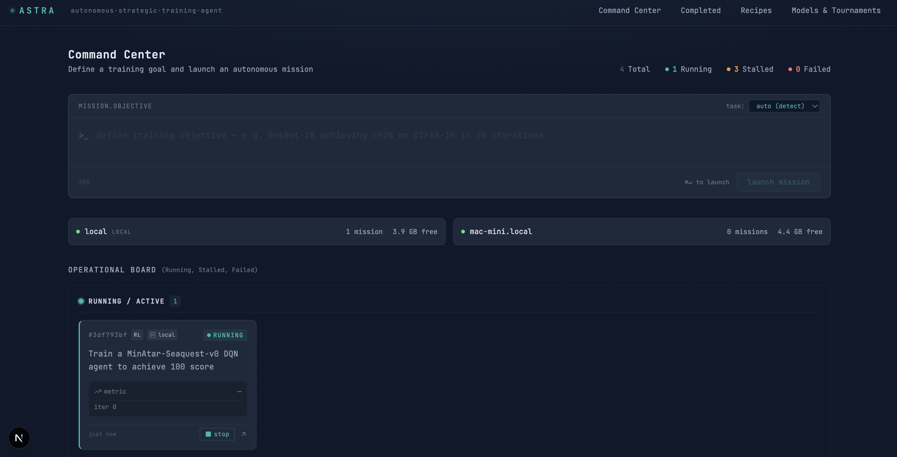
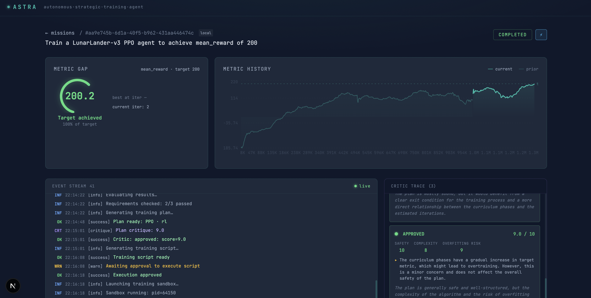
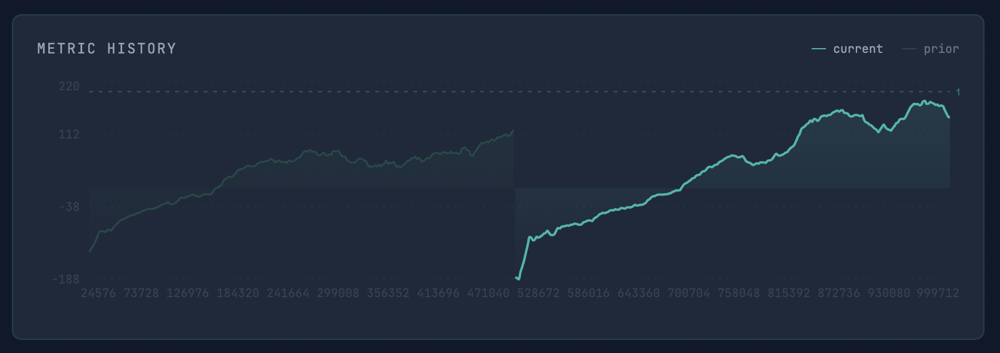
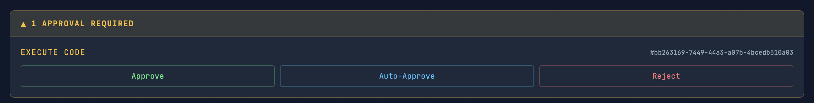
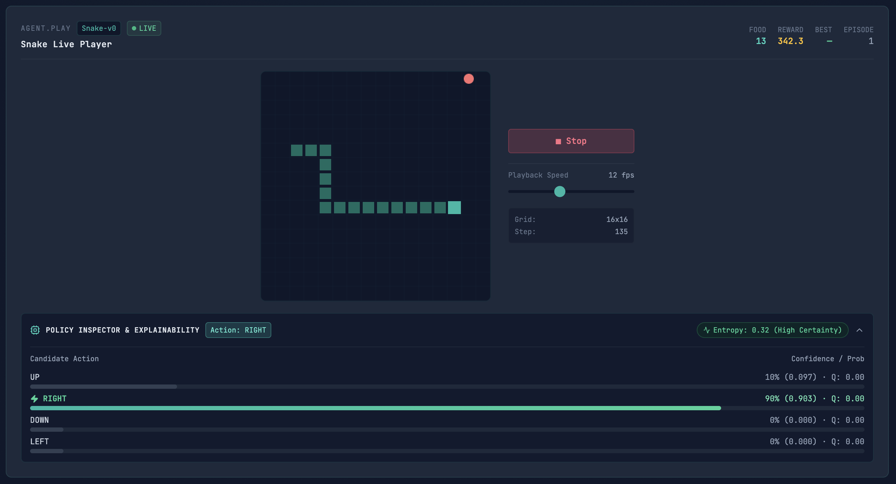
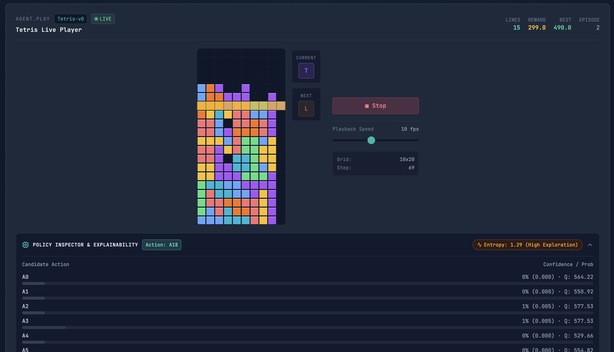
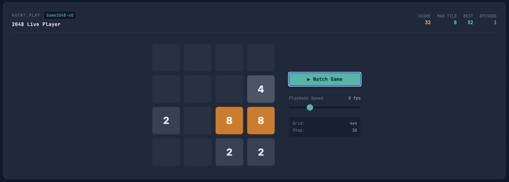
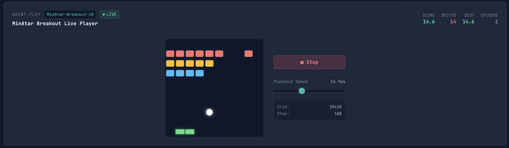
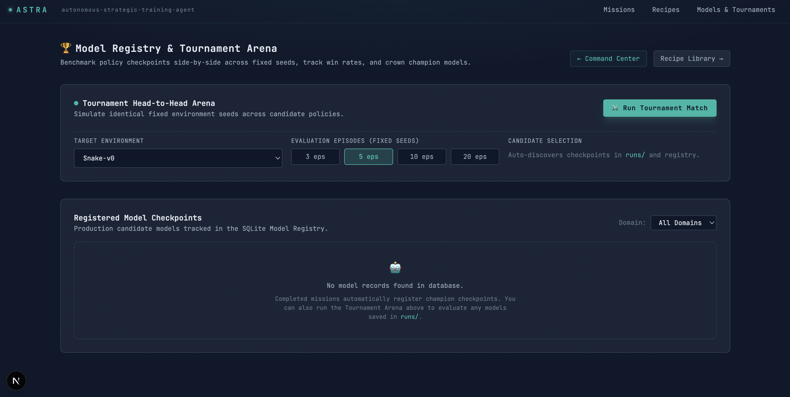
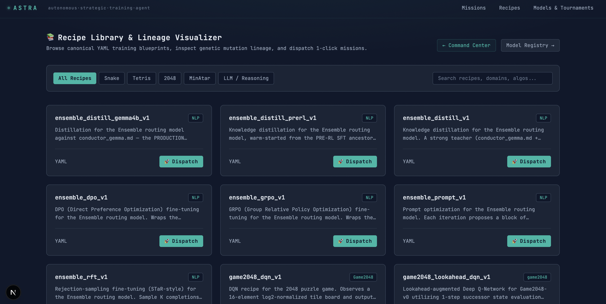

# ASTRA

**A**utonomous **S**trategic **Tr**aining **A**gent

ASTRA is an AI agent system that orchestrates end-to-end ML/RL training autonomously. You set the goal; ASTRA plans, implements, sandboxes, trains, evaluates, and iterates until the target metric is reached.

## Feature Highlights

- **End-to-End Autonomous Loop** — Plan → Critique → Implement → Sandbox → Train → Evaluate → Refine. Integrates GAN-style plan critique, automatic error recovery, and convergence guards that prevent runaway compute.
- **AstraGym × AstraRL (Epoch 9)** — All **online RL** is split into **AstraGym** worlds (`gym_id`: Gymnasium envs, AgentGym, e2e stubs, routing prompts) and **AstraRL** learners (`learner_id`: SB3 PPO/DQN/…, MLX GRPO/OPD). Astra’s loop stays the **Orchestrator** (`task_type`, recipes, sandbox, HUD). Packages: [`astragym/`](astragym/), [`astrarl/`](astrarl/). See [DESIGN.md § 2.4](docs/DESIGN.md).
- **Adaptive Escalating Pivots** — Stalled missions systematically escalate across hyperparameter tuning, network architecture mutations, algorithm switches, and environment reward shaping, with progress persisted across restarts. Goals that name a trainer stay on it; unnamed "RL agent" goals seed the env recipe algorithm and, once plateaued, switch to a *different* trainer (`SB3 PPO` → `PPO` is not a switch).
- **Model Registry & Tournament Arena** — Benchmark multiple models head-to-head on identical deterministic seeds (`2000 + ep`), each in its own `train_config` env (same table as `/models/{id}` play). Tracks score distributions and tie-split win rates; crowning a champion is exclusive per environment.
- **Recipe Library & Lineage Evolution** — Reusable YAML training blueprints with genetic mutation tracking (Lineage DAG), "Golden" recipe distillation from successful runs, and unified mission creation & dispatch with automatic canonical goal formatting (`Train a <env_id> <algo> agent to achieve <target_value> <metric_name>`).
- **Dedicated Completed Missions Archive & Proof Verification** — Dedicated historical repository (`/completed`) with multi-domain category tabs, instant search, sortable metrics, and verifiable requirement manifests (`score >= target: PASSED`, `clean sandbox exit: PASSED`).
- **Live Mission HUD & Model Play** — Missions stay on training (telemetry, memory gauges, pivots). Play / inference is `/models/{id}`: canvas players stream frame-by-frame Q-values, action probabilities, and Shannon policy entropy.
- **High-Throughput Custom Envs** — Pure Python/NumPy environments (>50k steps/sec) for Snake, Tetris, 2048 (with 1-step lookahead evaluation), the MinAtar arcade suite (Breakout, Space Invaders, Asteroids, Asterix, Freeway, Seaquest), Grid Pac-Man, and MultiTurnAgentGym.
- **Multi-Paradigm Post-Training & Hybrid Compute** — Environment RL (PPO, DQN, A2C, SAC, TD3), reinforcement fine-tuning (GRPO, DPO), Agentic RL (Agent GRPO / multi-turn tool trajectories), supervised fine-tuning (SFT, distillation, rejection sampling, STaR), on-policy distillation (OPD), calibrated decisions (RLCD), prompt edits, classical ML, retrieval, and generative recommendation (HSTU), across local Apple Silicon (Metal/MLX), local CUDA, and remote SSH compute nodes with real-time cluster memory visibility.


### Screenshots

| Command Center | Mission HUD |
|---|---|
|  |  |

| Metric History (current vs. prior run) | Auto-Approve & Approval Panel |
|---|---|
|  |  |

| Snake-v0 Live Viewer | Tetris-v0 Live Viewer |
|---|---|
|  |  |

| Game2048-v0 Live Viewer | MinAtar-Breakout-v0 Live Viewer |
|---|---|
|  |  |

| Model Registry & Tournament Leaderboard | Recipe Library & Lineage Visualizer |
|---|---|
|  |  |


## Documentation

| Doc | Purpose |
|---|---|
| [PRD.md](docs/PRD.md) | Product requirements & feature definitions |
| [DESIGN.md](docs/DESIGN.md) | Technical architecture & component design |
| [IMPLEMENT.md](docs/IMPLEMENT.md) | Phase-by-phase implementation roadmap |
| [UX_SPEC.md](docs/UX_SPEC.md) | Dashboard UX specification |

## Task and algorithm

A task is the objective. An algorithm is the update rule. `task_type` is the sandbox / preflight worker key.

### AstraGym × AstraRL (online RL)

| Layer | Package | Id | Owns |
|---|---|---|---|
| **AstraGym** | [`astragym/`](astragym/) | `gym_id` | Worlds: `reset` / `step`, rewards, eval |
| **AstraRL** | [`astrarl/`](astrarl/) | `learner_id` | Learners / checkpoints (SB3 + MLX GRPO/OPD) |
| **Orchestrator** | Astra loop | `task_type` | Missions, pivots, recipes, sandbox, HUD |

| Online worker | Typical `gym_id` | Typical `learner_id` |
|---|---|---|
| Environment RL (`rl`) | `gymnasium:<env_id>`, `agent_gym_vector` | `sb3_ppo` / `sb3_dqn` / … |
| Routing GRPO (`grpo`) | `routing_prompt` | `mlx_grpo_routing` |
| Agent GRPO (`agrpo`) | `agent_gym_text`, `e2e_stubs` | `mlx_grpo_traj` |
| OPD (`opd`) | `routing_prompt` | `mlx_opd` |

Recipes may set `gym_id` / `learner_id` explicitly; otherwise they are inferred. Offline workers (DPO, SFT, distill, RFT, STaR, RLCD, prompt, embed, rerank, HSTU) stay outside AstraRL. Full contract: [DESIGN.md § 2.4–2.5](docs/DESIGN.md).

| Task | Algorithms |
|---|---|
| Environment RL | PPO, DQN, A2C, SAC, TD3 (`rl`) — AstraGym × AstraRL SB3 |
| Reinforcement fine-tuning | GRPO (`grpo`, **online** → AstraRL `mlx_grpo_routing`), DPO (`dpo`, **offline**, outside AstraRL) |
| Agentic RL | Agent GRPO (`agrpo`, **online** → AstraRL `mlx_grpo_traj`) |
| Supervised fine-tuning | SFT (`sft`, `mlx_lora`), distillation (`distill`), rejection sampling (`rft`), STaR (`star`) |
| On-policy distillation | OPD (`opd`) — AstraGym `routing_prompt` × AstraRL `mlx_opd` |
| Calibrated decision | RLCD (`rlcd`) — routing `ensemble_rlcd_*`; one-shot `ensemble_decision_from_scratch_v1` (cold start); or staged foundation → specialize → focus. Product `:8082` = **c7b78b5d** + `decision_prompt` (A/B **68/74**, hermetic **167/167** + remap); bf94 = rollback |
| Prompt edit | rule append (`prompt`) |
| Classical ML | random forest (`ml`) |
| Retrieval | embedding (`embed`), reranker (`rerank`) |
| Generative recommendation | HSTU (`hstu`) |

## Quick Start

```bash
# 1. Create and activate the virtual environment
python3 -m venv .venv
source .venv/bin/activate

# 2. Install dependencies
pip install -r requirements.txt

# 3. Download local MLX models (required for first run)
huggingface-cli download mlx-community/Meta-Llama-3.1-8B-Instruct-4bit
huggingface-cli download mlx-community/Qwen2.5-Coder-7B-Instruct-4bit

# 4. Configure environment
cp .env.example .env   # edit as needed

# 5. Apply database migrations
alembic upgrade head

# 6. Run
make run   # backend + frontend → http://localhost:8200 / http://localhost:3200
```

## Project Structure

```
astra/
├── astragym/            # AstraGym — online RL worlds (gym_id): Gymnasium, AgentGym, e2e, routing
├── astrarl/             # AstraRL — online RL learners (learner_id): SB3 + MLX GRPO/OPD
├── backend/
│   ├── agent/          # LeadAgent, CriticAgent, CodeGenerator, ErrorAnalyzer, CodeSafetyClassifier, ModelManager, KVCache, inference providers
│   ├── analysis/       # SpatialAnalyzer (Grad-CAM), PolicyAuditor
│   ├── evaluator/      # SpecialistEvaluator, BenchmarkSuite, StressTester, ManifestEvaluator
│   ├── loop/           # LoopStateMachine, PivotEngine (Orchestrator)
│   ├── models/         # ORM models: Mission, Experiment, ModelRecord, RecipeRecord, ApprovalGate, Manifest
│   ├── routers/        # API route handlers
│   ├── sandbox/        # SubprocessSandbox, ContainerSandbox, SSHSandbox, SandboxManager
│   ├── schemas/        # Pydantic request/response models
│   ├── services/       # Crystallizer, RecipeLibrary, Evolution, VectorMemory, MissionState, Preflight, StateRecovery
│   └── trainers/       # RLTrainer, SFTTrainer, MLTrainer
├── frontend/           # Next.js 15 mission control dashboard (port 3200)
├── tests/
│   ├── unit/           # unit tests across all core modules (incl. test_astragym_astrarl)
│   └── integration/    # integration tests for the loop state machine and stress test suites
├── alembic/            # Database migrations
├── envs/               # Custom Gymnasium environments (Snake, Tetris, 2048, MinAtar suite, Grid Pac-Man, AgentGym)
├── recipes/            # YAML training recipes (gym_id / learner_id on online-RL recipes)
├── data/               # Runtime data: DB, weights, checkpoints, logs (gitignored)
├── docs/               # Architecture & design documents
├── .env.example
└── requirements.txt
```

## API Overview

Full endpoint reference is in [DESIGN.md § 5.4](docs/DESIGN.md). Interactive docs available at `http://localhost:8200/docs` once the backend is running.

## Make Commands

```bash
make run    # start backend (port 8200) + frontend (port 3200)
make stop   # stop both
make ports  # show port status for all services
```

## Strategic Development Milestones

ASTRA's architecture and capabilities are structured into nine thematic epochs (~10–18 phases each; Epochs 7 and 9 are shorter architecture milestones). Phase numbers stay chronological; epoch membership is thematic — see [IMPLEMENT.md](docs/IMPLEMENT.md).

| Epoch | Scope & Strategic Capabilities | Key Components | Status |
|---|---|---|---|
| **Epoch 1: Autonomous Execution Engine** (1–16) | Plan-critique-implement-train-eval loop, GAN critique, self-healing codegen, escalating pivots, vector memory. | `LoopStateMachine`, `LeadAgent`, `CriticAgent`, `CodeGenerator`, `PivotEngine` | ✅ Complete |
| **Epoch 2: RL & Lookahead** (17–24, 31–32) | Snake/Tetris Gym envs, lookahead DQN/PPO/A2C, flood-fill features, curriculum. | `SnakeEnv`, `TetrisEnv`, lookahead trainers | ✅ Complete |
| **Epoch 3: Post-Training Foundation** (25–41) | SSH Mini sandboxes, DPO/GRPO, Nodes HUD, checkpoint chaining, convergence/ceiling guards. | `SSHSandbox`, DPO/GRPO trainers, Nodes panel | ✅ Complete |
| **Epoch 4: Distill / RFT / Prompt & Mission Product** (42–50, 67–73, 75–77, 82) | Distill, RFT, prompt workers; Kanban/completed archive; eval & loop harden. | distill/rft/prompt recipes, Command Center | ✅ Complete |
| **Epoch 5: Arcade Suite & Live Play** (51–54, 65, 74, 79, 81, 83–85) | MinAtar suite, Grid Pac-Man, 2048; play on `/models/{id}`; policy auditor. | MinAtar envs, `MinAtarPlayer`, `PolicyAuditor` | ✅ Complete |
| **Epoch 6: Registry, Multi-Stage FT & STaR** (55–63, 66, 78, 80, 86) | Model registry & tournaments; SFT→DPO→GRPO conductor; STaR; recipe lineage. | `ModelRegistry`, conductor pipeline, `star_train.py` | ✅ Complete |
| **Epoch 7: AgentGym & Agentic RL** (64, 98–100) | MultiTurnAgentGym PPO env; AgentGym harden; Agent GRPO (`agrpo`) + e2e stubs. | `AgentToolGym`, `agent_grpo_train.py`, `agrpo` | ✅ Complete |
| **Epoch 8: OPD, Focused RFT & Calibrated Decisions** (87–97) | OPD; focused RFT lineage; RLCD; decision foundation → product `c7b78`. | `opd_train.py`, `rlcd_train.py`, decision recipes | ✅ Complete |
| **Epoch 9: AstraGym + AstraRL** (101–104) | Online RL as AstraGym (`gym_id`) × AstraRL (`learner_id`) under the Orchestrator. | `astragym/`, `astrarl/` | ✅ Complete |

> Full phase-by-phase implementation logs and technical changelogs are maintained in [IMPLEMENT.md](docs/IMPLEMENT.md).


## Hardware Target

Optimized for **Apple Silicon M4, 24 GB unified memory**.

Training sandboxes run locally by default (subprocess using the project `.venv`). To offload training to a remote machine over SSH (supporting `sft`, `dpo`, `grpo`, `agrpo`, `distill`, `opd`, `rft`, `rlcd`, `star`), set `ASTRA_SANDBOX_HOST` and optionally `ASTRA_SANDBOX_PYTHON` in `.env`.

| Machine | Role | Models / Load |
|---|---|---|
| MacBook M4 24 GB | MLX inference (Lead + Critic agents) + orchestration + local sandbox | Llama-3.1-8B-4bit (~4.5 GB) + Qwen2.5-Coder-7B-4bit (~4 GB) ≈ 8.5 GB |
| mac-mini M4 24 GB (optional) | Remote training execution via SSH (`sft`, `dpo`, `grpo`, `agrpo`, `distill`, `opd`, `rft`, `rlcd`, `star`) | Full 24 GB available for training subprocess (Gemma-3-12B-it-4bit, etc.) |

GPU training runs as a restricted host subprocess (Metal is not accessible inside Docker on Apple Silicon). Docker is used for cloud/CUDA targets only.
