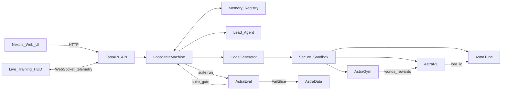
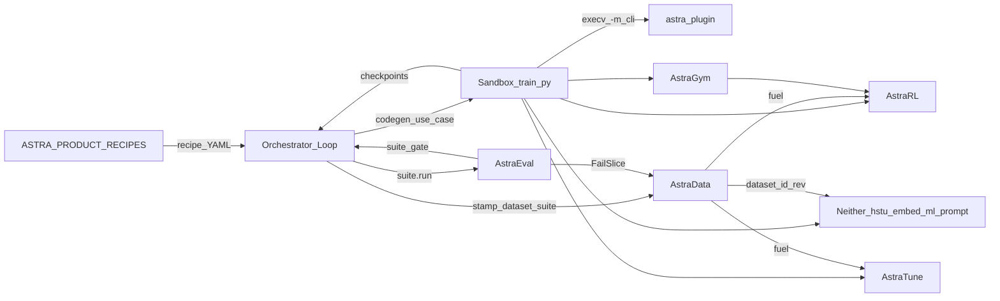
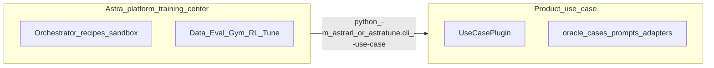
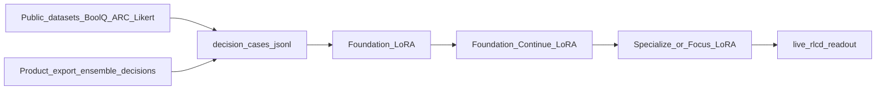
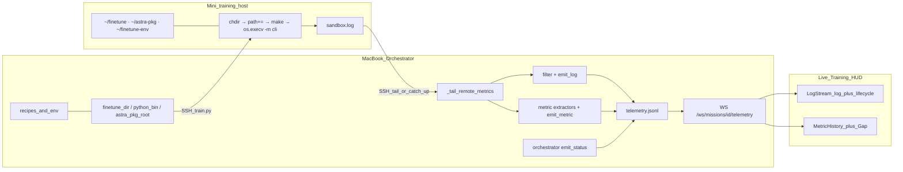
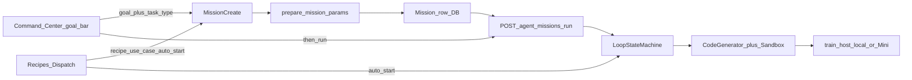

# ASTRA: Design Document

**Architecture Version:** 1.0.0  
**Core Stack:** Python, PyTorch, SQLAlchemy, FastAPI, Next.js 15

Phase-level incidents and code contracts live in [IMPLEMENT.md](IMPLEMENT.md).

---

## 1. System Overview

ASTRA is a modular system: a **Lead Agent** plans, a **LoopStateMachine** runs as **Orchestrator**, **CodeGenerator** writes sandbox scripts that call platform packages (AstraGym / AstraRL / AstraTune / …), and a **Next.js HUD** observes. Missions train; models play.

**Interactive / gym-coupled RL** uses **AstraGym** (`gym_id` worlds) and **AstraRL** (`learner_id` learners) under that Orchestrator (§ 2.4–2.5). That includes off-policy SB3 (DQN/SAC/TD3 replay). **Offline / dataset LM post-training** (SFT, DPO, distill, RFT, STAR, RLCD) uses the sibling **AstraTune** package — not AstraRL. **AstraData** + **AstraEval** close the complete flywheel (fuel → train → truth → FailSlice → fuel).

---

## 2. Components

### 2.1. Lead Agent

The planner. Cloud APIs are supported; production is **local MLX** on Apple Silicon (plan model + coder model). Inference shares unified memory with training, so the orchestrator must be able to evict models before a sandbox launch.

Inference practice: keep context/KV disciplined, prefer structured (schema-constrained) generation, and avoid loading Metal at import time on hosts without a GPU. Core matmul and quantization stay with MLX/MPS.

**Deployed split (both machines 24 GB unified memory):**
- **MacBook** — planning and codegen inference.
- **mac-mini.local** — training host (scripts over SSH, checkpoints and logs back on completion).

### 2.2. Autonomous Training Loop

Plan → generate script → sandbox → evaluate → pivot or stop.

- **Curriculum** advances when metrics justify it.
- **Pivots** escalate when a plateau holds: hyperparameters, then architecture, then algorithm (unless the goal named one), then reward shape. Deep plateau plus a long stretch without a new best is **converged below target** (terminal `stalled`). Reverting a bad architecture restores the checkpoint but still counts as a failed search.
- **Unnamed RL goals** take the env recipe’s algorithm; a named trainer stays locked.
- **Warm-start** loads a prior checkpoint only when algorithm and policy tensor shapes match. A smaller net than the best-known architecture is refused until deep plateau.
- **Fine-tune-remote** missions keep the recipe authoritative. Gym-coupled LM workers (`grpo` / `agrpo` / `opd`) dispatch via `astrarl.make(..., use_execv=True)`; offline LM workers (`sft` / `dpo` / `distill` / `rft` / `star` / `rlcd`) via `astratune.make(..., use_execv=True)`. Pivots may only touch a small per-type sampling or duration safelist so a LoRA warm-start cannot be broken by a hallucinated learning rate or layer count. Recipes one-click dispatch fills empty `target_metric` from recipe `metric_ceiling` / `target_metric`.

### 2.3. Memory

- **SQL registry** — experiments, models, mission state, recipes.
- **Vector memory** — lessons with enough metadata to retrieve by regime (env, HP, run).
- **Recipe library** — versioned YAML strategies, indexed for warm-start. Fine-tune dispatch uses canonical recipes only (no per-mission crystallization).
- **Working memory** — live logs and telemetry in the planner context.

Targets that exceed the **suite** ceiling (when `eval_suite` is set) or else the recipe’s `metric_ceiling` are rejected at create time.

### 2.4. Complete flywheel

Fuel → train → truth → FailSlice → fuel. **AstraData** versions fuel (`dataset_id@rev`); train packages produce checkpoints; **AstraEval** scores them (`suite_id@rev`) and emits FailSlices back into Data; the Orchestrator suite-gates completion and may inject `focus_cases` on the next turn.

**Wiring** (solid = forward path; labeled = Eval feedback):

| Layer | Role on the flywheel |
|---|---|
| **AstraData** | Fuel + FailSlice bank (`dataset_id@rev`) |
| **Train** | AstraGym × AstraRL, AstraTune, or Neither (`hstu` / `embed` / …) |
| **AstraEval** | Truth: `suite.run(ckpt) → {primary, case_ids}`, ceilings, `tournament_seed` |
| **Orchestrator** | Stamps `dataset_*` / `suite_*`, suite gate, FailSlice → optional `focus_cases` |

**Bind axes (mission create):** `task_type` · `gym_id`×`learner_id` · `use_case` · `dataset_id@rev` · `suite_id@rev`. Orchestrator stamps Data/Eval from the recipe. Shipped proving verticals: HSTU (`HstuHr10Suite`) and Ensemble routing (`RoutingBareEvalSuite` + FailSlice → `focus_cases`).

Platform packages, product plugins, and recipe packs are § 2.5 — not part of the flywheel loop itself.

### 2.5. Platform and product

**Astra** is the platform and training center. **Products** are use cases (plugin + prompts / cases / adapters) — not a second training host. Gym-coupled RL → AstraGym × AstraRL; offline LM → AstraTune; fuel/truth → AstraData × AstraEval. Inspired by Gym×RL splits; **not** NVIDIA NeMo / HTTP env servers.

| Astra owns | Product owns |
|---|---|
| Train CLIs, `run_*`, math, `lora_io`, missions, suite/dataset stamps | `UseCasePlugin` hooks, prompts, eval cases, adapters, `bare_eval` |
| Platform `recipes/` + pack discovery (`ASTRA_PRODUCT_RECIPES`) | Product recipe YAML under the product repo |

Contracts, `gym_id`/`learner_id` maps, facade/`os.execv` wiring, Mini path triad, pack search order, and plugin bind rules: [IMPLEMENT.md — Platform and product](IMPLEMENT.md#platform-and-product-contracts).

### 2.6. Specialist trainers

A task is the objective. An algorithm is the update rule under that task. `task_type` is the worker key for the algorithm. LoRA is a mechanism, not a task. Only Environment RL switches algorithms during a mission. `prompt` changes no weights.

| Task | Algorithms |
|---|---|
| Environment RL | PPO, DQN, A2C, SAC, TD3 (`rl`) |
| Reinforcement fine-tuning | GRPO (`grpo`), DPO (`dpo`) |
| Agentic RL | Agent GRPO (`agrpo`) |
| Supervised fine-tuning | SFT (`sft`, `mlx_lora`), distillation (`distill`), rejection sampling (`rft`), STaR (`star`) |
| On-policy distillation | OPD (`opd`) |
| Calibrated decision | RLCD (`rlcd`) |
| Prompt edit | rule append (`prompt`) |
| Classical ML | random forest (`ml`) |
| Retrieval | embedding (`embed`), reranker (`rerank`) |
| Generative recommendation | HSTU (`hstu`) |

**Online vs offline (data collection).** *Online* means training uses data the current policy collects during the run (act → reward → update → act again). *Offline* means training uses a fixed logged dataset only — no new env interaction or fresh rollouts in the optimizer loop. Hybrids exist (collect a batch online, then train offline on it). Package ownership is independent of that label (§ 2.5): gym-coupled → AstraRL; offline LM → AstraTune.

| Mode | In ASTRA | Package | Notes |
|---|---|---|---|
| **Online** | Env: PPO, A2C; LM: GRPO, Agent GRPO (`agrpo`); OPD (student rollouts) | AstraRL | On-policy samples from the live policy each step |
| **Offline** | Env: DQN/SAC/TD3 (replay) | AstraRL | Replay buffer, but still `astragym` × `sb3_*` |
| **Offline** | LM: DPO, SFT, distill, RFT survivors, STaR JSONL, RLCD `--cases` | AstraTune | Fixed preference pairs / labeled JSONL; no AstraGym |
| **Mixed** | DPO can *harvest* pairs online then optimize offline; RFT samples then SFT | AstraTune | Collection ≠ the loss; workers stay dataset-family |

Language-model PPO is not a reinforcement fine-tuning algorithm. PPO runs only as environment RL (including the AgentGym MLP policy). Rejection sampling (`rft`) keeps oracle-correct student completions and runs SFT on them. GRPO is **online** RL: scores on-policy **single-turn** rollouts with the routing oracle and a group-relative advantage. Agent GRPO (`agrpo`) is **online multi-turn** tool RL: K trajectories in AgentGym text (or e2e stubs), trajectory-level reward, GRPO over assistant turns — not routing `score_completion`. DPO is **offline** preference learning via AstraTune (`mlx_dpo`): the same oracle labels chosen/rejected pairs, then a preference loss trains on that set (no policy-gradient step on live rollouts). RLCD (AstraTune `mlx_rlcd`) trains a calibrated distribution over declared option strings after `Answer:` with a Brier (or log) score; Choice-facing runs use fixed `--cases` JSONL (offline data) with empty-rationale stage 1 to match live readout. Live Choice endpoints that post an empty rationale should use recipes with `empty_rationale: true`.

**Decision foundation approach** (Astra recipes dispatch only): public HF cases and/or product exporters → `decision_cases` JSONL → foundation LoRA → optional continue → specialize/focus → live RLCD readout. Product recipes may also one-shot from-scratch or routing-only RLCD. Promote rules live in the product’s decision data docs.

The remote wrapper passes `--cases` when the recipe sets `cases`, omits `--routing-only` when `routing_only: false`, and passes `--eval-max-cases` when `eval_max_cases` > 0. Dispatch Mini RLCD **only** through Astra missions (`POST /recipes/{name}/dispatch`) — never bare product train scripts outside a mission. Empty-rationale pivots on `temp`/`num_generations` are no-ops. HSTU (`hstu`) trains a from-scratch PyTorch Hierarchical Sequential Transduction Unit on MovieLens-1M next-item prediction (same loop shape as a small LSTM recommender); local like `embed`/`rerank`, not Mini MLX, and scores Hit Rate@10.
**Environments.** Arcade envs are 10×10 NumPy Gym wrappers. Seaquest, Asterix, and Grid Pac-Man follow their source rules closely enough that play and checkpoints stay honest (oxygen/surface, spawn/ramp, leftover ghosts chase, mouth faces movement). Env classes load lazily so importing the package does not load every game.

**Code generation.** The coder writes `train.py`. Mechanical post-patches exist because a 7B coder will omit imports, `register()`, or env construction, and a healer that treats every `NameError` as a missing import can swap in the wrong env. SFT falls back to a canonical runner when the AST is bad. Gym-coupled SB3 scripts use `astragym.make(gym_id)` + `astrarl.make(learner_id, …)` (no bare `gym.make`); legacy `gym.make` is rewritten to AstraGym.

**Remote fine-tune.** Mini holds a product **workspace** (e.g. `~/finetune`) plus an editable Astra tree (`~/astra-pkg` by default) and runs trainers under `~/finetune-env`. Canned wrappers bake a **path triad** (absolute paths at codegen). Train stdout (`sandbox.log`) is SSH-tailed (full-log catch-up on reattach): noise-filtered lines → **`emit_log`** (Event Stream narrative) and metric extractors → **`emit_metric`** (Metric History / Gap / goal). Orchestrator lifecycle stays **`emit_status`**. LogStream is **not** a regex-reconstructed status checklist — unknown trainer banners still appear as `type=log`. Metric-required lines: [`astratune/stdout_contract.py`](../astratune/stdout_contract.py); UX: [UX_SPEC §2.2](UX_SPEC.md). Path-verify smokes set `steps_per_eval` far above train length (baseline + final only). The DPO/GRPO reliability gate prefers the log's `Eval every N steps` over plan HP and does **not** treat that end-only SPE as pairs-collapsed. DPO and routing GRPO both ensure `<save-dir>/best/` after Final Eval; exit sync can promote final adapters into local `checkpoints/best/` if `best/` was still missing (manifest `file_exists`).

| Knob | Typical Mini value | Role |
|---|---|---|
| `finetune_dir` | `/Users/kewang/finetune` | Workspace cwd + product data; parent often on `PYTHONPATH` for the plugin |
| `python_bin` | `/Users/kewang/finetune-env/bin/python` | MLX + pip-installed platform packages (`os.execv` target) |
| `astra_pkg_root` | `/Users/kewang/astra-pkg` | `sys.path.insert` before `import astrarl` / `astratune` |
| `use_case` | importable module | Product `UseCasePlugin` — bound at **mission create** (`MissionCreate.use_case`, goal marker `use_case: …` / `--use-case …`, or Lead Agent from the product named in the goal). Not recipe HP. |
| `ASTRA_USE_CASE` | env (optional) | Last-resort bare-CLI fallback when `--use-case` was omitted; **not** the mission product binding. |

Resolution for `astra_pkg_root`: recipe HP `astra_pkg_root` → env `ASTRA_PKG_ROOT` (`settings.pkg_root`) → `/Users/kewang/astra-pkg`. Facade call is `astratune.make` / `astrarl.make(..., use_execv=True).learn()` — the wrapper process image is replaced by `python -m astrarl.cli` / `astratune.cli` (same pid), which loads the product plugin via plan-baked `--use-case` (or `ASTRA_USE_CASE` only if unset). Batch size is clamped to the split. Loss-like metrics are lower-is-better.

**Chaining.** SFT → DPO (and similar) is two missions. The second warm-starts the first’s adapter; trainers read LoRA shape from the adapter config rather than trusting the planner.

### 2.7. Sandbox

Where training runs.

- **Apple Silicon** — no Metal passthrough in Docker. GPU work is a restricted host subprocess (or SSH to the Mini). Docker is for CPU/isolation only.
- **CUDA** — container with GPU toolkit.
- **Isolation** — memory/compute caps; writes limited to mission data and the registry.

### 2.8. Evaluator and introspection

**AstraEval** owns authoritative mission gates when `suite_id@rev` is stamped: `suite.run(ckpt) → {primary, case_ids}`, suite ceilings at create, FailSlice emit into AstraData, and tournament seeds (`2000 + ep`). Play on `/models/{id}` and the tournament both load that checkpoint's `train_config` env so the leaderboard matches the player. Arcade **benchmark / stress** helpers remain for introspection outside suite-gated missions. **Saliency** and a **policy auditor** (action distribution, entropy) explain the same play page.

### 2.9. Resilience

- **Safety critic** — GAN-style review of the plan before execute.
- **Mission manifest** — structured source of truth for the next iteration, not a growing chat log.
- **Validation contract** — primary metric plus health signals (entropy, loss stability).

---

## 3. Starting a mission (goal ↔ recipe ↔ product ↔ train)

Both entry points share one pipeline: **`POST /missions`** (Command Center goal bar) and **`POST /recipes/{name}/dispatch`** (Recipes one-click → same `MissionCreate`). `prepare_mission_params` builds the stored mission fields; the loop then plans, codegens, and trains.

### 3.1. What each piece is

| Piece | Where it lives | Role at mission start |
|---|---|---|
| **Goal (mission prompt)** | `Mission.goal` (from create body or canonicalized from recipe description + target) | Human intent: env/product, algorithm, target. Lead Agent reads this. Explicit `use_case: <module>` / `--use-case <module>` markers bind the product without a separate field. |
| **Recipe** | Disk YAML / DB record | Known-good **training knobs** for a worker: `task_type`, adapter paths, LoRA, `finetune_dir` / `python_bin` / `astra_pkg_root`, epochs, ceilings. Optional `dataset_id`/`dataset_rev`, `eval_suite`/`suite_rev`, multi-`stages`. Does **not** own the product plugin name. Astra `recipes/` is **platform-only** (Snake/Tetris/MinAtar/…); product packs (e.g. Ensemble `astra_recipes/`) are discovered via `ASTRA_PRODUCT_RECIPES=use_case:/path` after the platform dir. |
| **`task_type`** | Create body, recipe, or inferred from goal keywords | Worker key (`rl`, `dpo`, `grpo`, …) → sandbox / preflight / which facade CLI. |
| **`use_case` (product)** | Bound at **create** → `plan.hyperparameters.use_case` → baked `--use-case` | Importable `UseCasePlugin` module (e.g. Ensemble → `ensemble`). See resolution order below. |
| **`dataset_id@rev`** | Recipe → plan stamp (AstraData) | Versioned fuel; create/preflight bind paths (e.g. HSTU ML-1M). |
| **`suite_id@rev`** | Recipe `eval_suite`/`suite_rev` → plan stamp (AstraEval) | Authoritative score + ceiling; FailSlice → optional `focus_cases`. |
| **`current_plan`** | Seeded at create when a recipe is present; refreshed by Lead Agent / stages | What the loop executes: recipe name, algorithm, hyperparameters, stages, Data/Eval axes. |
| **Target metric** | Create override → **suite ceiling** when suite stamped, else recipe `target_metric` / `metric_ceiling` → parsed from goal | Completion gate for the HUD / evaluator. |

### 3.2. Two ways to start

**A. Goal-first (Command Center)**  
User types a prompt (and optional algorithm dropdown). Backend may infer `task_type` from keywords. If no recipe is attached, the Lead Agent chooses algorithm / `task_type` and may warm-start knobs from a close recipe-library match. When recipe is still omitted but `use_case` is bound, the default recipe stem is `{use_case}_{task}_v1` (e.g. `ensemble` + `dpo` → `ensemble_dpo_v1`); `distill` has no silent default (multiple product variants). Stem resolution walks `settings.recipes_path` then `ASTRA_PRODUCT_RECIPES` packs. For product fine-tunes, name the product in the prompt or write `use_case: <module>` so the plugin is bound before codegen.

**B. Recipe-first (one-click dispatch)**  
`dispatch` builds `MissionCreate(recipe=…, goal?=…, use_case?=…)`. Goal text is canonicalized from the recipe description + target when omitted. `current_plan` is seeded with the recipe name (and stage-0 HPs for multi-stage). Finetune recipes still need a product: pass `use_case` on the dispatch body, put a marker in `goal`, or let the Lead Agent set it when the goal names the product. Recipe YAML must not hardcode `use_case` as a training HP.

### 3.3. Product (`use_case`) resolution

Order used when baking the train wrapper:

1. **`MissionCreate.use_case`** (API / Recipes prompt / dispatch JSON) — **authoritative** when set
2. **Explicit marker in the goal** — `use_case: ensemble` or `--use-case ensemble`
3. **Lead Agent** — may set `hyperparameters.use_case` from the product named in the goal (e.g. “Ensemble routing” → `ensemble`); create/goal binding overwrites this before codegen; never accept `learner_id` values (`mlx_dpo`, …) as `use_case`
4. **`ASTRA_USE_CASE` env** — last-resort bare-CLI fallback only when `--use-case` was omitted; **not** the mission product binding

Recipe hyperparameters supply paths and LoRA settings; they are not the place to stamp the product module. Product recipe **files** live in the product pack (`ASTRA_PRODUCT_RECIPES`), not in Astra `recipes/`.

### 3.4. After create (same for A and B)

1. Critic approves or revises the plan.
2. Codegen writes the sandbox script (canned facade for remote LM workers).
3. Autonomy gates may pause for execute-code approval.
4. Sandbox trains; telemetry streams to the HUD.
5. When `suite_id@rev` is stamped, AstraEval suite-gates the checkpoint (primary metric + FailSlice into AstraData); otherwise the loop scores against the goal / recipe metric.
6. Loop pivots, completes, or stalls. Ensemble follow-ons may inject `focus_cases` from the latest FailSlice (same suite). Successful **RL** (and similar) runs may crystallize a recipe into the platform `recipes/` dir, or into the product pack when `plan.hyperparameters.use_case` maps to `ASTRA_PRODUCT_RECIPES`; fine-tune-remote types do not auto-crystallize.
7. Registry and model page pick up the checkpoint for play and tournaments (same env table; seeds via `astraeval.tournament_seed`).

---

## 4. Security and autonomy

One gate is live: **execute code**. A static pass auto-approves localhost telemetry and blocks obvious danger; ambiguous scripts go to an LLM classifier, then a human if needed. Resource and deploy approval gates are schema-only today (not enforced in the loop).

| Mode | Execute-code gate |
|---|---|
| **Guided** | Always a human decision (UI approve or explicit auto-approve click). |
| **Supervised** (default) | Classifier may auto-approve; otherwise wait. |
| **Full autonomy** | No gate; script runs. |

The HUD shows loop status, metric gap, pivot history, and the approval queue.

---

## 5. Runtime

**Persistent.** FastAPI process, asyncio mission loops, SQLite (or Postgres), Chroma sidecar, `data/` volume for weights and logs.

**Transient.** One sandbox per training iteration (subprocess, SSH, or container). The model manager keeps LLM and trainer from fighting over unified memory.

**Recovery.** On boot, running/planning/evaluating missions are inspected. A live sandbox is reattached and only polled. A dead sandbox resets the mission to pending so the loop can relaunch from the last checkpoint. Shutdown terminates the sandbox so the next process does not inherit an orphan. Telemetry back-fills the HUD after a reconnect.

Interactive API: `http://localhost:8200/docs`.
